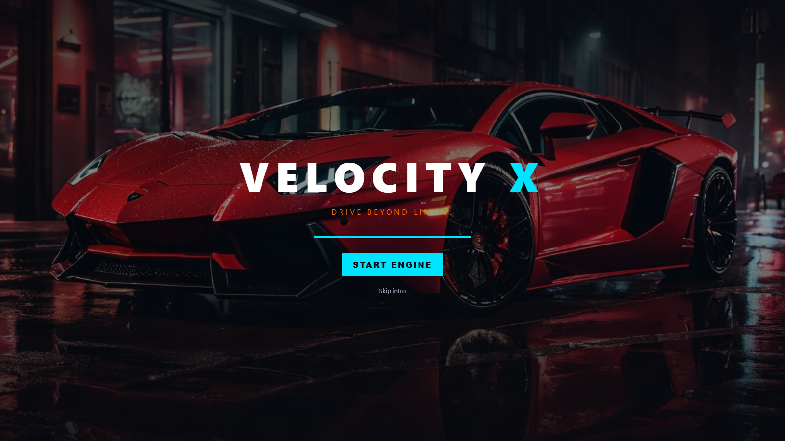
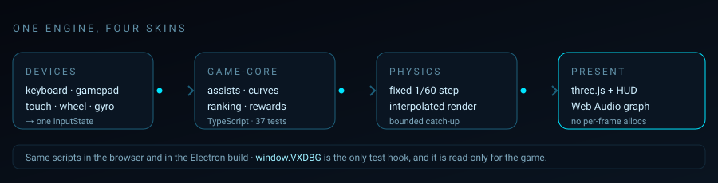

<div align="center">


**An arcade racer that runs on a laptop keyboard, an Xbox pad, an on-screen steering wheel and a phone held in one hand — from one shared physics engine, with one shared set of rules.**

<br />


<br />


<a href="#quick-start"><b>Quick start</b></a> ·
<a href="#the-twelve-problems-that-were-actually-eaten">The bugs that were fixed</a> ·
<a href="#measured-not-claimed">Measured numbers</a> ·
<a href="#architecture-one-input-record-everywhere">Architecture</a> ·
<a href="#controls">Controls</a> ·
<a href="#what-is-not-shipped">Roadmap</a>

</div>

---



<p align="center"><sub>The title screen as it actually renders — no mock-up, no stock art in the frame above the car.</sub></p>

## Contents

| | |
|---|---|
| 🎮 **[What this is](#what-this-is)** | The pitch in six lines |
| ⚡ **[Feature tour](#feature-tour)** | Mobile, audio, auto-drive, controller, garage |
| 🧠 **[Architecture](#architecture-one-input-record-everywhere)** | One `InputState`, four layers, zero duplicated rules |
| 🔧 **[The twelve problems](#the-twelve-problems-that-were-actually-eaten)** | Every bug that was root-caused, not papered over |
| 📊 **[Measured, not claimed](#measured-not-claimed)** | Real FPS, real frame time, real rpm, real heap |
| 🚀 **[Quick start](#quick-start)** | Browser, desktop app, `.exe` installer |
| ⌨️ **[Controls](#controls)** | Keyboard, Xbox/PS, touch, wheel, gyro |
| 🗂 **[Project map](#project-map)** | What lives where and why |
| 🧪 **[Testing](#testing)** | 53 automated checks + 32 browser specs |
| 🗺 **[Not shipped](#what-is-not-shipped)** | The list that keeps this README honest |
| 📄 **[Licences](#licences-and-credits)** | Including what is *not* documented |

---

## What this is

VELOCITY X is a complete arcade racing game — 12 cars, 6 locations, 6 modes, a career, a garage, dynamic
weather, rivals, replays, a time-trial ghost and an online time-trial leaderboard — built as **plain
classic scripts on top of three.js**, with the *game rules* moved out into a tested TypeScript package.

Three things make it more than a tutorial project:

1. **The same physics play every input device.** Keyboard, Xbox/PlayStation pad, on-screen touch buttons,
   a draggable ±450° steering wheel and a gyroscope all funnel into **one** `InputState` record. The AI
   driver in SELF/AUTO mode drives through that exact same record — it is not a scripted animation, it is
   the same car with a virtual driver.
2. **The frame budget is measured, not assumed.** Fixed 1/60 s physics with interpolated rendering, no
   object allocation in the physics or render path, a bounded replay buffer, a dynamic resolution governor
   and a quality ladder from *Low* to *Ultra*. The numbers in [Measured, not claimed](#measured-not-claimed)
   were printed by the tests, including the ugly ones.
3. **The bugs are documented.** [TEST_REPORT.md](TEST_REPORT.md) lists 15 concrete defects with the root
   cause of each: the car that could not turn away from a wall, the input object allocated 60 × N times a
   second, the replay buffer that grew forever, the engine sound that faded to silence because its gain was
   multiplied by 0.5 sixty times a second.

---

## Feature tour

<div align="center">

</div>

### 📱 Mobile first, not mobile "also"
Layout is built from `env(safe-area-inset-*)`, `dvh` and `clamp()` — never from fixed pixels. Breakpoints
at 320 / 360 / 390 / 430 / 600 / 768 / 1024 / 1280+; a portrait HUD column and a separate short-landscape
shape; the steering wheel is clamped to `max(132, min(360, setting, 0.5 × min(vw,vh)))` so it can never
cover the pedals on a 320 px phone; every tap target is ≥ 48 px and buttons are **sized with `width/height`**
instead of `transform: scale()` (the old approach left a ghost copy of the pad on screen). 12 viewport
sizes are audited automatically — overflow, tiny text, small targets, stretched canvas, HUD overlaps.

### 🔊 Engine sound that is a graph, not a loop
Every noise in the game is **synthesised at runtime**: no `.mp3`, no samples, nothing to license. Three
oscillators plus filtered noise per engine profile (V8, supercar, turbo JDM, EV whine); pitch follows the
*actual* rpm; rev-limiter stutter, shift drops, lift burble; wind, road and tyre layers driven by speed,
surface and slip angle; brake squeal, turbo whistle and blow-off, nitro; distance, doppler and stereo
panning for rivals. Parameters are smoothed with `setTargetAtTime` and **no node is created per frame**
(measured: 1 → 1 nodes across a full-throttle run).

### 🤖 SELF / AUTO drive — a driver, not a rails camera
Press `T` and a real AI takes the wheel: lane keeping, corner braking from curvature, traffic avoidance,
safe gaps, nitro on straights, auto-recovery. Cinematic cameras cycle automatically. Any real input — a key,
a stick, the wheel, a touch button — **instantly and smoothly takes control back**. XP accrues at a
documented reduced rate, and the choice is saved.

### 🎮 Controllers that are actually implemented
Gamepad API with hot-plug toast, first active pad wins, standard mapping **plus** a fallback table for pads
that report no mapping at all: analog RT/LT, stick steering with deadzone + linear/soft/aggressive curve +
smoothing, full menu navigation with a focus ring and auto-repeat, dual-rumble haptics (kerbs, off-road,
slides, nitro, collisions) with an intensity slider, and unplugging mid-race pauses the race instead of
driving on with dead input. Keyboard *and* pad remapping, with duplicate rejection.

### 🏁 The rest of the game
12 cars · 6 locations · 6 modes · career · garage & customisation · upgrades that change physics · dynamic
weather during a race · replays with switchable cameras · time-trial ghost · four synthesised horn voices
that make traffic pull aside (and are relayed to other players online) · separate master / engine / music /
effects / environment buses · installable PWA with an offline cache · Wake Lock · fullscreen + landscape
lock · battery saver.

---

## Architecture: one input record, everywhere

<div align="center">

</div>

```
DEVICES            GAME-CORE (TypeScript, 37 tests)        PHYSICS              PRESENT
keyboard  ─┐       ┌──────────────────────────────┐        fixed 1/60 s   ┌──────────────┐
gamepad   ─┤       │ applyAssists()  steer/TC/ABS │   ──▶  interpolated ──▶  three.js scene
touch     ─┼──────▶│ trackCurve()  ranking        │        bounded         HUD (DOM)
wheel     ─┤       │ rewards · setup · save       │        catch-up        Web Audio graph
gyro      ─┘       └──────────────────────────────┘                        no per-frame allocs
```

- `packages/game-core/src/input.ts` owns **every** input rule: deadzones, response curves, assists
  (steering, traction, ABS, auto-brake, one-pedal, stability). It is compiled to `web/vendor/game-core.js`
  by `npm run build`, so browser, desktop app, AI driver, replay and online all run the identical code.
- Because every device produces the same record, the **AI driver, the ghost replay and the human** are
  interchangeable at the `player.input` boundary. That is the whole design in one sentence.
- `web/js/controls.js` is DOM, gestures and persistence only. It publishes `window.VXDBG` so browser tests
  can read live state without the game exposing internals.
- All 11 scripts are classic scripts sharing one global scope, so top-level names must stay unique — and
  `npm run check` enforces it: **11 scripts, 409 globals, 0 problems**.

---

## The twelve problems that were actually eaten

Each of these was reproduced first, then fixed, then re-measured. The full table with all 15 rows is in
[TEST_REPORT.md §1.1](TEST_REPORT.md).

| # | Symptom the player felt | Real root cause | What was done |
|---|---|---|---|
| 1 | "Lagging" — a 20–40 ms hitch every second | A **fresh input object** per car per physics step (60 × N/s) + `forEach` closures + an `Object.assign`ed key map | One shared record mutated in place; plain `for` loops; cached key map |
| 2 | Stutter that crept up over a long session | Replay recorder allocated `(cars × 3) + 2` objects 10×/s and **grew without limit** | One flat `Float32Array`, hard cap 2400 samples (4 min) |
| 3 | Rain made the frame rate dip | `BufferAttribute.getY/setY` per component = **3 200 calls/frame** for 800 drops | Direct typed-array indexing |
| 4 | Phone stuttered when the URL bar moved | `resize()` reallocated the GL drawing buffer on *every* event, even unchanged | Size guard + guarded `visualViewport` |
| 5 | HUD jank | `querySelectorAll` + closures + `classList` + style writes every 33 ms; wheel canvas repainted at 30 Hz identically | Cached nodes, guarded writes, repaint only on real change |
| 6 | Car kept driving after Alt-Tab | A blurred window never fires `keyup`; a cancelled touch never fires `pointerup` | `vxDropInput()` on `blur`/`visibilitychange` |
| 7 | **"The car is stuck against the wall"** | Steering is speed-scaled, so a car wedged square at 0 km/h cannot turn away | Stuck assist: 3 s pinned with a pedal held → back on the racing line |
| 8 | **"The car won't steer at all"** (touch) | The racing-line steering assist replaced up to 55 % of a **full lock at standstill** and could invert it | Assist now fades in below ~10 m/s and can never reverse the player's direction (2 new unit tests) |
| 9 | Frozen picture, but the game "running" | One exception skipped `renderer.render()` forever after `rAF` was re-armed | Frame wrapped; 90 consecutive failures fall back to the menu |
| 10 | Engine sound faded to silence | Gain multiplied by 0.5 **sixty times a second** | Level recomputed and scaled once per change |
| 11 | HUD elements stacked on each other | `#mm` had no `position`; the portrait speed chip sat above a `clamp()`-sized block | `#mm{position:absolute}`, portrait column re-ordered |
| 12 | **Ghost / duplicate touch buttons** | `transform: scale()` on a fixed layer: the box changed without a reflow, the old raster stayed | Buttons *sized* via `width/height`, floored at 48 px |

Also fixed: a 230 px wheel covering 72 % of a 320 px screen, 12 px checkboxes with 22 px hit boxes, a
"Wake Lock was refused" toast covering the HUD, and a race started from the Garage sitting on a dead
countdown forever (`VX_SUSPEND` was never cleared).

---

## Measured, not claimed

All of it is printed by the tests in this repository. Browser runs are headless Chromium on **SwiftShader**
— a software rasteriser with no GPU, i.e. the worst case that exists. Treat the FPS column as a *lower
bound*, and read the honest caveats in [§4 of the report](TEST_REPORT.md).

```text
npm run verify:fast
  check-globals ......... 11 scripts, 409 globals, 0 problems
  tsc --noEmit .......... clean
  game-core unit tests .. 37 / 37 passed
  headless scenarios .... 16 / 16 passed
  long drive ............ top 171 km/h, 0 frames at the barrier, tyre wear 4.06 %
```

**Frame-time budget** — 20 s of a 6-car race:

```text
perf: 14 fps, 71.5 ms avg, 100 ms 1% low, 100 ms worst,
      22 draw calls, governor 0.70 / 0.70, context restores 0,
      heap growth -11.4 MB
```

- `1 % low == worst == 100 ms` is the `dt` clamp: software rendering only presents ~10–14 frames/s, so the
  worst frame is capped by the rasteriser, not by game logic.
- **Heap growth is negative** — the GC keeps up, the replay buffer is bounded, there is no upward trend.
- The resolution governor settles at 0.70 and **stops moving** (steps down on a bad second, needs eight good
  ones to climb back), so the picture does not breathe.

**Engine audio**, read live from the audio graph:

| State | RPM | f0 | Note |
|---|---|---|---|
| Idle at race start | 1500 | 100 Hz | 4-cylinder: `f = rpm / 60 × cyl / 2` |
| 3 s full throttle | 6495 | 433 Hz | chasing the 7200 rpm red line |
| 8 s, still flat | 5895 | 393 Hz | the gear change dropped the note |

Node count **1 → 1** across the whole sample: no audio node is created per frame, only `AudioParam`
automation runs.

**Auto drive**, 20 s hands-off in the open world: **+408 m, 95 km/h, 0 resets, 0 collisions**, and one real
`W` press handed control straight back. Longer soak (headless, 30 min): 37 147 m, 74 km/h average, 5
collisions, 0 resets.

**Responsive layout**: 12 viewport sizes with DPR 3 and touch enabled — 320×568 through 1920×1080, portrait
*and* landscape, driven through a real race. 12 / 12 pass.

---

## Quick start

```bash
# 1. browser (nothing to build — it is plain scripts)
npm run serve                 # http://127.0.0.1:8099  →  redirects to web/index.html

# 2. Windows desktop app (Electron: contextIsolation on, nodeIntegration off, sandboxed)
npm run desktop

# 3. Windows installer  →  desktop/dist/
npm run installer
```

> **Do not open `web/index.html` from disk.** `file://` blocks the car-model fetches and the start button
> stays at "LOADING 3D CARS". Use the local server, or the desktop app.

Only two dev dependencies in this folder — TypeScript and Playwright. three.js is vendored, so the browser
build works offline; `npx playwright install chromium` is needed once for the browser tests.

### Deploy

| Target | How |
|---|---|
| **Vercel** | Import the repo and deploy — no settings to change. [vercel.json](vercel.json) runs `npm run build:web` (a dependency-free namespace check, no bundler) and serves `web/` as the site root, with immutable caching for `/vendor` and `/models`. |
| **GitHub Pages** | Serve the `web/` folder (any static host works; there is no server-side code in the game). |
| **Online leaderboard** | `npm run server` — a small Node + `ws` relay in `server/` with validation and rate limits. |

---

## Controls

**Keyboard**

| Action | Key | Action | Key |
|---|---|---|---|
| Accelerate | `W` / `↑` | Handbrake | `Space` |
| Brake / reverse | `S` / `↓` | Nitro | `Shift` |
| Steer | `A` `D` / `←` `→` | Camera | `C` |
| Pause | `Esc` / `P` | Reset car | `R` |
| Horn | `H` | Take over from AUTO | `T` |
| Look back | `B` | Map / replay | `M` |

**Xbox / PlayStation / generic pad**

| Action | Button | Action | Button |
|---|---|---|---|
| Accelerate | `RT` (analog) | Nitro | `A` / `Cross` |
| Brake | `LT` (analog) | Handbrake | `X` / `Square` |
| Steer | Left stick (curve + deadzone) | Camera | `Y` / `Triangle` |
| Horn | `B` / `Circle` | Look back | `LB` |
| Reset car | `RB` | Map | `Back` |
| Rewind | `R3` | Pause | `Start` |

Menus are fully navigable: D-pad/stick to move (with auto-repeat), `A` select, `B` back, visible focus ring.
Unplugging a pad mid-race pauses instead of driving blind.

**Phone (touch)**

Two steering choices, picked from the main menu or the pause menu: **◎ WHEEL** (draggable on-screen wheel,
±450° = ±1.0 lock, smooth auto-centre) or **📱 TILT** (gyro, with the iOS permission request, auto-calibration
each race, and an automatic fall-back to the wheel when the phone sends no sensor data). Four buttons:
**GAS**, **BRAKE**, **NOS**, **HORN** — all ≥ 48 px, multi-touch safe, released on blur / background /
rotation so nothing ever sticks. Portrait and landscape have their own layouts. A race pauses itself when
the app goes to the background.

**Download / install (Android, iPhone, desktop)**

Tap **⬇ DOWNLOAD GAME** on the splash or the main menu. Android / Chrome / Edge show the install prompt;
on iPhone the button shows the *Share → Add to Home Screen* steps. The service worker stores every file
(scripts, textures, all four car models), so the installed game opens full-screen and plays **offline**.

---

## Project map

```
web/                        the game — index.html, css/, js/, models/, vendor/, manifest, sw.js
  ├─ js/game.js             scene, render loop, HUD, weather, race flow
  ├─ js/gameplay.js         physics step, fixed 1/60, interpolation, replay buffer
  ├─ js/input.js            the live readInput path (keyboard + pad + touch + wheel + gyro)
  ├─ js/controls.js         DOM, gestures, persistence, window.VXDBG test bridge
  ├─ js/audio.js            engine graph, layers, buses, panning
  ├─ js/autodrive.js        SELF/AUTO AI driver + cinematic cameras + take-over
  ├─ js/horn.js             four synthesised horn voices + AI reactions
  ├─ js/models.js           GLB loading with procedural fallbacks
  └─ vendor/                three.js r149, GLTFLoader, game-core.js (generated)
packages/game-core/         TypeScript rules shared by every device + 37 unit tests
desktop/                    Electron wrapper (main, preload, prep) and installer config
server/                     Node + ws relay: time-trial leaderboard, horn/taunt relay
tools/                      static server, headless simulation, vendor build, global-name checker
tests/                      Playwright browser specs (responsive, quality, controls)
assets/                     README artwork (animated SVG) + screenshots
```

Build pipeline: `npm run build` → `tools/build-vendor.js` + `packages/game-core/build.js` → `web/vendor/`.
When you ship a change, bump `CACHE` in `web/sw.js` and the `?v=` tags in `index.html`, or players will keep
the old files from the offline cache.

---

## Testing

| Command | What it proves |
|---|---|
| `npm run check` | 11 classic scripts, 409 globals, **0 name clashes** |
| `npm run typecheck` | `tsc --noEmit` clean over the core package |
| `npm test` | **37 / 37** unit tests (Node's own runner, `--experimental-strip-types`) |
| `npm run sim` | 16 headless game scenarios: physics, AI, ranking, weather, save |
| `npx playwright test tests/responsive.spec.ts` | 12 screen sizes, layout audit + screenshots |
| `npx playwright test tests/quality.spec.ts` | every car × both modes, Auto drive, frame time, audio graph |
| `npx playwright test tests/controls.spec.ts` | pad mapping, wheel, gyro, horn, settings, pause flow |
| `npm run verify` | everything above, in order |

The browser specs drive the **real** scripts, the **real** physics and the **real** Gamepad API (with a
stubbed pad) — not mocks of the game.

---

## What is *not* shipped

Anything not finished is labelled "coming soon" in the UI, and it stays out of this list:

- **No physical-device testing.** Controller paths are exercised through the real Gamepad API; gyro through
  synthetic orientation events; touch through emulated touch at phone size. Real phones, DualSense triggers,
  cheap generic pads and real rumble still need a human. iOS Safari is not covered by these runs.
- **No real GPU was measured.** All browser numbers come from SwiftShader. The 60 FPS desktop / 30–60 FPS
  phone target is *designed for* (fixed timestep, dynamic resolution, Auto quality, zero per-frame
  allocation) but was not measured on hardware in this session.
- Online is a validated relay, not physics-authoritative: no matchmaking, friends or accounts. No force
  feedback, no WebXR, no multi-monitor, no localisation.
- Tunnels/bridge are visual structures on flat road (no elevation). Pit lane is decorative.
- Living track, touge duels, driver-DNA coach, telemetry, nitro-skill scoring, crews/economy, photo mode,
  livery/tuning/track editors — **not implemented, and never shown as working**.
- `models/*.glb` and `web/img/*` came with the project and their licences are **not documented**; the game
  falls back to its own procedural car meshes, so nothing depends on them. See [LICENSES.md](LICENSES.md).

---

## Licences and credits

three.js (MIT / Apache-2.0) and its `GLTFLoader` are vendored with their licence headers intact. Everything
in `web/js/`, `packages/`, `server/`, `tools/`, `tests/` and `desktop/` was written for VELOCITY X. Every
sound is synthesised at runtime, so there are no audio licences to chase. The full, deliberately honest
breakdown — including which files have **undocumented provenance** — is in [LICENSES.md](LICENSES.md).

<div align="center">
<br />

<br /><br />
<b>VELOCITY X</b> — built, measured, and documented. Numbers first, adjectives later.
<br />
<sub>If the only thing you take from this repo is <code>packages/game-core</code> and <code>tests/</code>, that is fine too.</sub>
</div>
